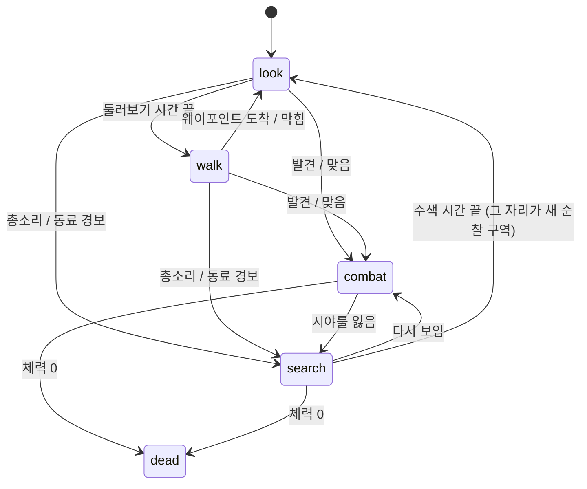

# 적 동작 로직

적 AI의 구조와 판단 규칙을 정리한 문서다. 코드 기준은 `src/enemy.ts`(공통 AI와 총잡이), `src/enemy2.ts`(레이저 로봇), `src/enemies.ts`(무리 관리와 소리 전달), 수치는 `src/config.ts`의 `ENEMY`, `ENEMY2`다.

## 1. 구성

| 파일 | 역할 |
|---|---|
| `Enemy` (enemy.ts) | 두 적이 함께 쓰는 AI: 상태 전환, 시야, 순찰, 전투 이동, 피하기, 수색 |
| `GunnerEnemy` (enemy.ts) | 총잡이: 3발 점사 |
| `WalkerEnemy` (enemy2.ts) | 카메라 몸통 보행 로봇: 충전 후 레이저 한 발 |
| `Enemies` (enemies.ts) | 배치, 매 프레임 갱신, 동료 경보, 플레이어 총소리 전달 |

두 종류의 차이는 무기(`attack`, `weaponTick`)와 애니메이션, 그리고 속도·각도 수치뿐이다. 판단 로직은 같다.

## 2. 상태

적은 두 층의 상태를 가진다.

- `state`: `look`(서서 둘러보기) · `walk`(순찰) · `combat`(전투, 플레이어가 보임) · `search`(수색, 안 보임) · `dead`
- `tactic`: 전투/수색 중의 행동. `hold`(서서 쏘기) · `move`(자리 옮기기 또는 피하기)

## 3. 매 프레임 판단 순서 (`think`)

1. 피하기 쿨다운을 줄인다.
2. **시야 검사**(0.2초마다): 보이면 마지막 위치(`lastSeen`)를 갱신하고, 수색 중이었으면 전투로 돌아가고(하던 이동은 이어 감), 순찰 중이었으면 새로 전투를 시작한다(`engage`).
3. **맞은 직후면** 피할 자리를 고른다(`planMove(dodge=true)`).
4. 상태별 행동(아래 4~7절).

## 4. 평상시: 둘러보기와 순찰

- **look**: 제자리에 서서 고개를 좌우로 돌린다. 1.5~3.2초(`lookTime`) 뒤 웨이포인트를 고른다.
- **웨이포인트**: 순찰 중심(`home`)에서 2.5~10m(`patrolRadius`) 안의 무작위 점. 맵 안이고 가는 길이 막히지 않은 곳만 쓴다(12번 시도).
- **walk**: 0.8m/s(레이저 로봇 0.55m/s)로 걸으며 좌우 45°까지 자주 고개를 돌린다. 도착하면 다시 look, 막히면 0.8~1.8초만 둘러보고 다시 출발한다.
- **고개 돌리기(`scan`)**: 한 방향을 0.4~0.9초 보고 반대쪽이나 정면으로 돌린다. 고개 한계는 몸 기준 좌우 60°(로봇 70°).

## 5. 감지

| 방법 | 조건 | 결과 |
|---|---|---|
| 시야 | 거리 30m 안, 고개 방향 기준 시야각 110°, 눈→플레이어 머리 레이가 벽/물체에 막히지 않음 | 전투 시작(첫 발 0.25초 뒤) |
| 피격 | 총에 맞음 | 쏜 위치를 알고 전투 시작(첫 발 0.4초 뒤) + 피하기 |
| 총소리 | 플레이어가 쏜 위치에서 16m(`hearRange`) 안 | 그 위치로 수색. 벽 너머도 들린다 |
| 동료 경보 | 전투를 시작한 동료에게서 12m(`alertRadius`) 안 | 동료가 본 위치로 수색 |

총소리와 경보는 이미 전투 중인 적에게는 영향이 없다. 들은 즉시 소리 난 쪽으로 고개를 돌린다.

## 6. 전투: 쏘고 → 움직이고 → 또 쏘기

### 서서 쏘기 (`hold`)
- 팔(렌즈)을 0.35초(로봇 0.3초)에 걸쳐 들어 올린다.
- 목표가 몸 정면 25°(로봇 40°) 안이면 상체 비틀기(최대 45°/50°)와 고개로만 따라가고, 벗어나면 발을 떼서 몸을 돌린다.
- 조준 오차가 4°(로봇 3°) 안이고 플레이어가 16m(`fireRange`) 안이면 쏜다. 더 멀면 겨누고 지켜보기만 하다가, 다가갈 거리(성향의 `approach`+4m) 안이거나 맞았으면 앞으로 나온다(돌격 또는 옆으로 돌기).
  - **총잡이**: 0.4초 간격 3발 점사, 다음 점사까지 1.3~2.0초. 퍼짐 2°. 가슴과 머리 사이를 노린다.
  - **레이저 로봇**: 0.55초 충전 후 렌즈가 보는 방향으로 발사, 다음까지 1.9~2.9초. 퍼짐 1.2°. 렌즈(몸통)는 스프링으로 돌아서 움직이는 플레이어보다 늦으므로, 전투 중에는 스프링을 2배로 빠르게 하고(`combatSpringMul`), 발사 때 렌즈 방향에서 10°(`trackAssist`)까지는 0.05초(`aimLag`) 늦게 따라간 조준점 쪽으로 꺾어 쏜다. 충전 중 방향을 바꾸거나 엄폐하면 피할 수 있다.
- 공격 1~2회(로봇은 1회, `volleysBeforeMove`)를 마치면, 점사나 충전이 끝나기를 기다렸다가 자리를 옮긴다.

### 자리 옮기기 (`planMove`, dodge=false)
후보 14개를 뽑아 점수가 가장 높은 곳으로 간다.

- **방향**: 플레이어를 기준으로 옆쪽(좌우 45~135°). 플레이어가 6m보다 가까우면 뒤로 물러나는 쪽, 18m보다 멀면 다가가는 쪽으로 치우친다.
- **거리**: 1.5~3.5m(`moveDist`). 맵 안이고 가는 길이 막히지 않은 곳만.
- **점수**: 옆으로 많이 움직일수록 +, 그 자리에서 플레이어가 보이면 +0.8(계속 쏠 수 있게), 안 보이면 -0.3, 약간의 무작위.
- 체력이 2 이하면 50% 확률로 엄폐 자리를 우선한다.
- 갈 곳이 없으면 그 자리에서 계속 쏜다.

### 이동 중 (`move`)
- 다리는 가는 방향으로, 상체와 고개는 플레이어 쪽으로(한계까지) 향한다.
- 이동 중에는 쏘지 않는다.
- 속도 1.25m/s(로봇 0.85m/s). 도착하거나, 막히거나, 3.5초가 지나면 다시 `hold`로 돌아가 공격 횟수를 새로 정하고 0.15초 뒤부터 쏜다.
- 이동 중 잠깐 플레이어가 가려져도 이동은 끊기지 않는다.

## 7. 맞으면 피하기

- 맞으면 바로 `planMove(dodge=true)`로 피할 자리를 고른다. 거리는 일반 이동의 1.1배, 속도 1.8m/s(로봇 1.25m/s).
- **65%**(`coverChance`) 확률로, 또는 체력이 2 이하면 항상 **엄폐 자리**(플레이어 머리가 안 보이는 곳, 점수 +1.5)를 우선한다. 그 외에는 계속 쏠 수 있는 옆자리를 고른다.
- 엄폐로 숨었으면 0.8~1.8초(`coverHold`) 머문 뒤 다시 나와 수색하거나 쏜다.
- 피한 뒤 1.2초(`dodgeCooldown`) 동안은 또 맞아도 다시 피하지 않는다(계속 도망만 다니지 않게).
- 이미 시작한 레이저 충전은 피하는 중에도 발사되고, 남은 점사는 멈춘 뒤 이어서 쏜다.

## 8. 수색 (`search`)

시야를 잃었거나 소리/경보를 들었을 때.

1. 엄폐 대기 시간이 남아 있으면 기다린다.
2. 마지막으로 본 곳(또는 소리 난 곳)이 1.5m보다 멀면 1.0m/s(로봇 0.7m/s)로 걸어가며 둘러본다. 최대 8초, 막히면 멈춘다. 걷는 동안 수색 시간은 최소 2.4초로 유지된다.
3. 도착했거나 갈 수 없으면 서서 고개를 넓게 돌린다.
4. 수색 시간 4초(`searchTime`)가 다 되면 `look`으로 돌아가고, **지금 위치가 새 순찰 중심**이 된다. 그래서 적은 싸운 곳 근처로 모여든다.
5. 그 사이 다시 보이면 바로 전투로 돌아간다.

## 9. 이동과 충돌

- 모든 이동(`stepToward`)은 몸을 목표로 돌리면서, 정렬된 정도에 따라 속도를 올린다(정면에서 45° 넘게 벗어나 있으면 거의 제자리에서 돈다).
- 다음 위치가 충돌 박스(적 키 높이 안에 걸치는 것)나 맵 경계에 닿으면 멈추고 `blocked`를 돌려준다. 그래서 벽을 뚫지 않는다.
- 웨이포인트와 전투 이동 목표는 미리 직선 경로를 0.4m 간격으로 검사해서 막힌 곳은 고르지 않는다.
- 적끼리는 충돌하지 않는다.

## 10. 배치

- `spreadSpots`(src/spread.ts)로 걸어서 갈 수 있는 빈 칸 중 서로 가장 먼 자리부터 고른다(farthest-point sampling). 플레이어 시작점 12m 안은 후보가 모자랄 때만 쓴다.
- 종류는 총잡이와 레이저 로봇을 번갈아 놓는다. 수: 컨테이너 기지 8+5, 백룸 16+11, 사막 마을 11+8, 항구 창고 12+9, 시험장 4+3.
- 처음 둘러보기 시간을 0.5~2.5초로 흩어 놓아 모두가 동시에 걷기 시작하지 않는다.

## 11. 조절 값 요약 (`ENEMY` / `ENEMY2`)

| 값 | 총잡이 | 레이저 로봇 | 의미 |
|---|---|---|---|
| `health` | 5 | 5 | 체력(1발 = 1) |
| `patrolRadius` | 10 | 10 | 순찰 반경(m) |
| `lookTime` | 1.5~3.2 | 같음 | 서서 둘러보는 시간(초). 짧을수록 활발 |
| `patrolSpeed` | 0.8 | 0.55 | 순찰 속도(m/s) |
| `fov` / `sightRange` | 110° / 30m | 같음 | 시야 |
| `volleysBeforeMove` | 1~2 | 1 | 자리 옮기기 전 공격 횟수 |
| `moveDist` | 1.5~3.5 | 같음 | 한 번에 옮기는 거리(m) |
| `combatSpeed` | 1.25 | 0.85 | 전투 이동 속도 |
| `dodgeSpeed` | 1.8 | 1.25 | 피하는 속도 |
| `dodgeCooldown` | 1.2 | 같음 | 다시 피할 수 있을 때까지(초) |
| `coverChance` | 0.65 | 같음 | 피할 때 엄폐를 고를 확률 |
| `coverHold` | 0.8~1.8 | 같음 | 엄폐 뒤 머무는 시간(초) |
| `searchTime` | 4 | 같음 | 수색 시간(초) |
| `searchSpeed` | 1.0 | 0.7 | 수색 이동 속도 |
| `alertRadius` | 12 | 같음 | 동료 경보 반경(m) |
| `hearRange` | 16 | 같음 | 총소리 듣는 거리(m) |

## 12. 디버그로 확인하기

브라우저 콘솔의 `__debug`로 확인할 수 있다.

- `__debug.enemyInfo()`: 각 적의 상태, 전술(`tactic`), 위치
- `__debug.placeEnemy(i, x, z, yawDeg)`, `freezeEnemy(i, on)`: 특정 적만 세워 두고 시험
- `__debug.hitEnemy(i)`: 맞혀서 피하기 확인
- `__debug.fire(true)`: 총소리로 주변 적이 수색하러 오는지 확인
- `__debug.god(true)`: 맞아도 피해 없음(이때 `playerHits`는 늘지 않는다)

## 13. 성향과 사람다운 판단 (2026-11-13 추가)

적마다 성향(`persona`)이 하나씩 있고(`ENEMY_STYLES`, enemies.ts가 `ENEMY_STYLE_MIX`를 섞어 골고루 나눔), 수치는 적마다 ±12% 흔든다.

| 성향 | 특징 |
|---|---|
| 돌격형 `rusher` | 반응 빠름(0.18초), 좋아하는 거리 5m, 잘 안 숨고 곧장 다가오며 쏜다 |
| 소총수 `rifleman` | 거리 10m, 피하기/엄폐 반반, 다가오기·돌아오기·내다보기를 섞는다 |
| 우회형 `flanker` | 거리 8m, 옆으로 돌아 들어오기를 주로 쓴다 |
| 신중형 `cautious` | 거리 13m, 맞으면 거의 숨고 오래 머문다. 엄폐 가장자리에서 내다보며 쏘고 다시 숨는다. 이동 중엔 안 쏜다 |

- **맞으면**: 쏜 쪽을 알고 시야 검사를 바로 한다. 성향 확률(`dodge`, 체력 2 이하면 85%)로 피하고, 아니면 그 자리에서 1.6배 빠르게 돌아서 맞서 쏜다. 안 보이면 서서 그쪽으로 몸을 돌린다(`threatT`).
- **이동하며 쏘기**: 엄폐로 뛰어드는 중이 아니면, 주인공이 상체+고개로 겨눌 수 있는 범위에 보일 때 이동 중에도 쏜다(퍼짐 ×1.7, `moveSpread`). 신중형은 제외.
- **총구 확인**: 눈에는 보여도 총구 앞이 낮은 엄폐물에 막히면 쏘지 않고 머리를 노리거나, 그래도 막히면 옆으로 비켜선다(`peek`).
- **숨었다가 다시 오기**: 놓친 뒤 `pursuit`초 동안은 엄폐에서 잠깐 기다린 뒤 성향 비중대로 `push`(곧장 다가오기) / `flank`(옆으로 돌기) / `peek`(보이는 자리로 내다보기)를 골라 반복해서 다가온다. 놓칠 때 주인공이 달아나던 쪽으로 0.8초 앞을 짐작한다. 2.2m 안까지 오면 서서 둘러보는 수색으로 바뀐다.
- **쏜 뒤 자리 옮기기**: 성향과 거리로 `strafe` / `push`(멀면) / `flank` / `cover`(쏘고 숨기)를 고른다. 후보 점수에 좋아하는 거리와의 차이가 들어간다.
- **인기척**(`sense`): 주인공이 가만히 1.4m, 앉아 걸으면 2.2m, 걸으면 4.5m, 달리면 8m 안에 있으면 안 보여도 알아채고 돌아선다(벽 너머 포함). 이미 그쪽을 보는데 안 보이면 찾으러 간다.
- **소리**: 총소리는 짧게, 동료 경보는 길게 쫓기를 건다(무기를 들고 다가온다).
- 디버그: `__debug.enemyInfo()`에 `style`, `move`가 나온다.
- **다가오는 거리**(`approach`, 돌격 18 / 소총수 14 / 우회 16 / 신중 11m): 이보다 멀면 쫓거나 다가오지 않는다. 먼 경보·총소리는 1.2초 돌아보고 순찰로 돌아가고, 멀리서 보이면 그 근처에서 옆으로 움직이며 쏜다(한 번 더 서서 쏨). 가까우면 다가오되 좋아하는 거리의 절반~60%에서 멈춘다.
- **숨었다가 다시 돌아다니기**: 엄폐 대기는 0.5~1.2초(×성향), 수색 중 서서 둘러보는 시간은 반으로, 수색이 끝나면 0.3~0.9초 뒤 바로 순찰을 시작한다.
